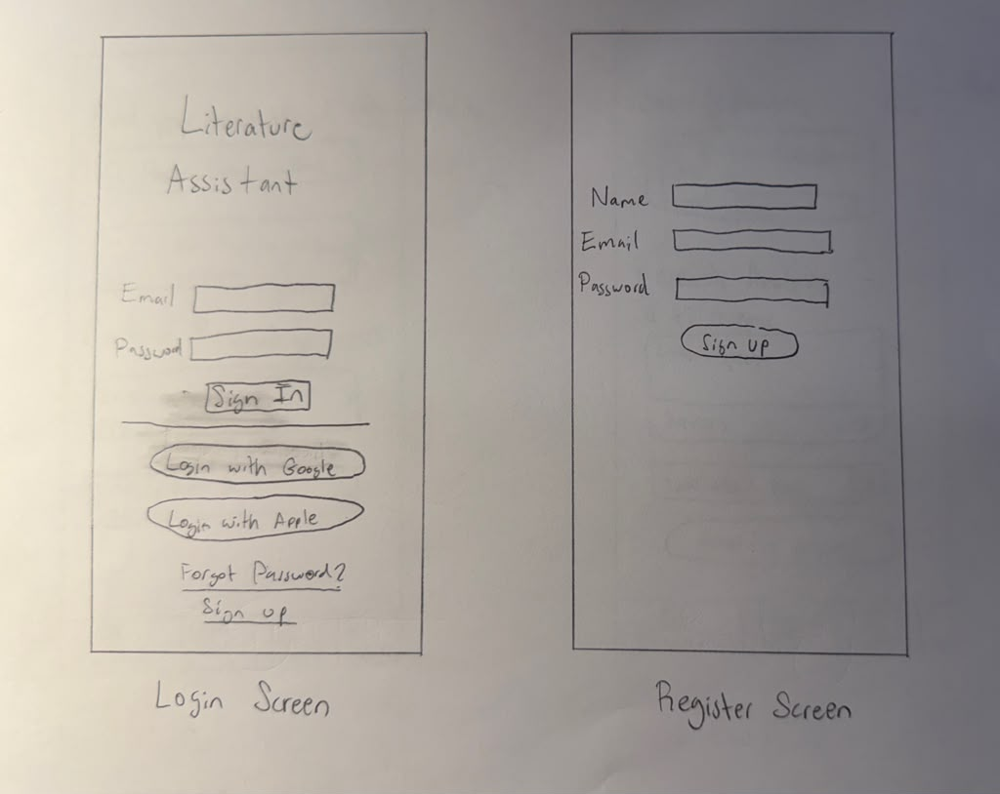
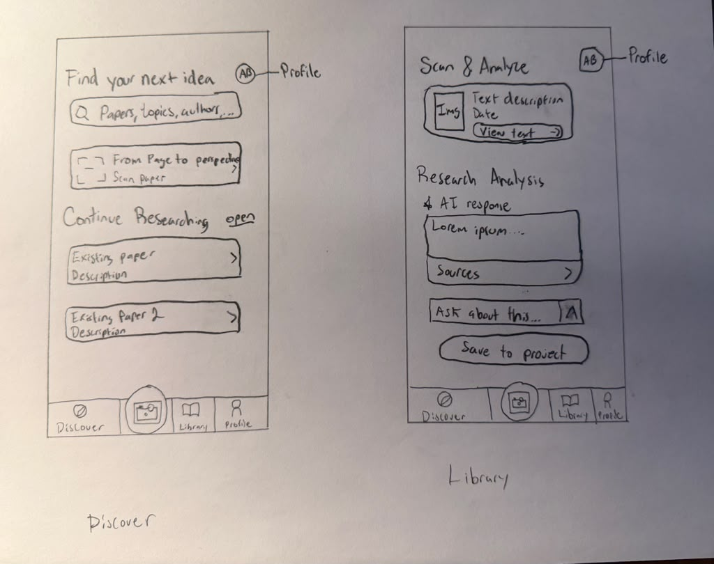
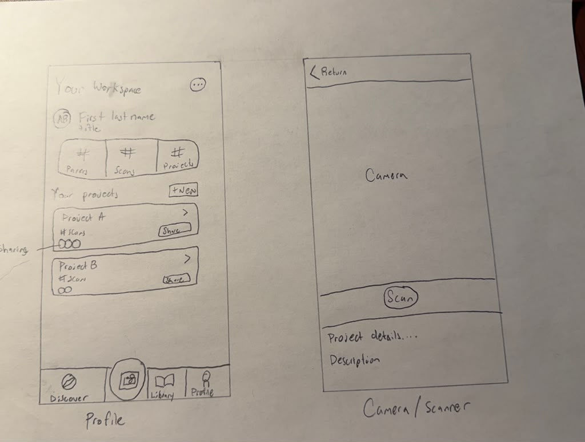
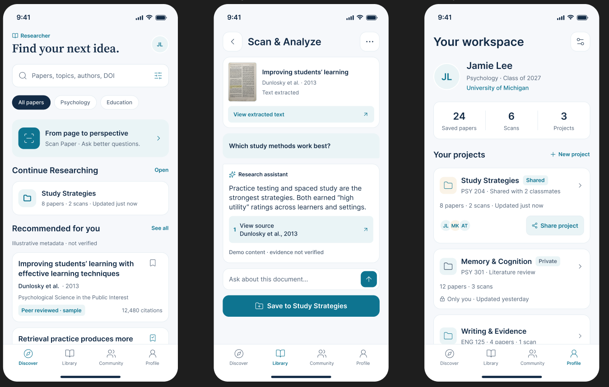

Literature Assistant Project - README
===

# Literature Assistant

## Table of Contents

1. [Overview](#Overview)
2. [Product Spec](#Product-Spec)
3. [Wireframes](#Wireframes)
4. [Schema](#Schema)

## Overview

### Description

Literature Assistant application allows users to research, document, and collaborate on common essay problems. It's users will be able to start a conversation with artificial intelligence, on the topic of their research goals. They can create projects and organize all the material research their work is building off of. Importantly, the applications users will be able to collobarate by sharing projects with other users.

### App Evaluation
Broad evaluation of the application's criteria.

- **Category:** Education/Productivity
- **Mobile:** Mobile only, requires native camera OCR and barcode/QR scanning to capture phyiscal papers.
- **Story:**  Turns physical pages, textbooks, and articles into AI-analyzed research with traceale citations
- **Market:** Students and researchers.
- **Habit:** Heavy users will include researchers who commonly cite other scholar materials for their own publications, but the average student will use it for each of their written assignments 3-5 times per school semester.
- **Scope:** The application is narrow in scope intentionally to ensure that the target audiences needs are met and over satisfication levels.

## Product Spec

### 1. User Stories (Required and Optional)
In this section, we document high-level user stories that are required and optional for the application.

**Required Must-have Stories**

* User can register an account, login, view personal workspace stats ( saved papers, scans count, active projects), and logout.
* User can query academic papers by kewywords, topic, author name, or DOI cia external open API e.g., OpenAlex / Semantic Scholar).
* User can point the camera at a physical printed paper or screen to scan text, extract titles/DOIs, or capture specific paragraphs using Apple VisionKit.
* User can inspect verified paper details, including title, authors, publication, venue, citation counts, and extracted raw text.
* User can ask specific questions about the scanned/selected document and receive responses that cite traceable sources.
* User can create named progect folders and save papers or scans directly into them.
* User saved papers, chat history, and project folders persist across sessions via a cloud backend.

**Optional Nice-to-have Stories**

* User can scan barcoes or QR codes printed on journals or instant identification.
* User can invite classmates to a project folder for shared research and paper collections.
* User can run cross-paper AI synthesis across an entire collectio of papers to identify conflicting findings and research gaps.
* User can download and read fill-text PDFs natively inside an in-app viewer.

### 2. Screen Archetypes
In this section, we document all granular level user stories based on the screen archetype.

- [ ] **Login Screen**
* Required User Feature: User can log in.
* Required User Feature: User can create new account.
- [ ] **Register User**
* Required User Feature: User provides basic details for sign up: name, unique email, and password.
* Optional User Feature: User can sign up via Single Sign-On options like Google or Apple (iCloud).
- [ ] **Discover**
* Required User Feature: At a glance, user can continue working on their existing research.
* Required User Feature: User can search across existing papers, topics, authors, and DOI.
* Optional User Feature: User can filter content on screen
- [ ] **Library**
* Required User Feature: User can continue conversations about existing projects and documentation the application has already found.
* Required User Feature: User can save their conversation to an existing project.
* Required User Feature: User can continue the conversation to drilldown the topic.
* Required User Feature: User has a link available to reach the source directly.
- [ ] **Profile**
* Required User Feature: User has a single score of saved papers, scans, and projects. 
* Optional User Feature: Tapping on a single score report allows you to drilldown to the specific listings.
* Required User Feature: User has a list of projects they have created, or that have been shared with them.
* Required User Feature: User can create a new project on demand.
* Required User Feature: User can logout.
- [ ] **Camera/Scanner**
* Required User Feature: User can allow the application to have access to the camera interface.
* Required User Feature: User can take a picture of a document.
* Required User Feature: User can add the document to their existing project.
* Required User Feature: User can begin a conversation about a new scan.

### 3. Navigation

**Tab Navigation** (Tab to Screen)

- [ ] Discover, e.g., Search bar, scan action banner, recent projects, recommended papers.
- [ ] Library, e.g., Saved paper repository, collections, and recent scans filter.
- [ ] Profile, e.g., User metrics, project folders list, and account settings
...
...

**Flow Navigation** (Screen to Screen)

- [ ] [**Login Screen**]
  * Leads to [**Discover Screen**]
  * Leads to [**Register User**] 
- [ ] [**Register User**]
  * Leads to [**Discover Screen**] 
  * Leads to [**Login Screen**]
- [ ] [**Discover Screen**]
  * Leads to [**Camera, Scanner**]
  * Leads to [**Library**]
  * Leads to [**Profile**]
- [ ] [**Camera, Scanner**]
  * Leads to [**Library**]
  * Leads to [**Discover Screen**] 
- [ ] [**Library**]
  * Leads to [**Discover Screen**]
  * Leads to [**External Browser / Source**]
  * Leads to [**Camera, Scanner**]
  * Leads to [**Profile**]
- [ ] [**Profile**]
  * Leads to [**Discover Screen**]
  * Leads to [**Library**]
  * Leads to [**Login Screen**]
## Wireframes





### [BONUS] Digital Wireframes & Mockups

### [BONUS] Interactive Prototype

## Schema 


### Models

**User**
| Property | Type | Description |
|----------|------|-------------|
| id | String | Unique user identifier supplied by the authentication provider |
| name | String | User's full name |
| userName | String | User-designated display name |
| email | String | User's email address used for authentication |
| createdAt | Date | Date and time the account was created |

**Project**
| Property | Type | Description |
|----------|------|-------------|
| id | String | Unique identifier for the project |
| name | String | Project name entered by the user |
| ownerId | String | Reference to the User who owns the project |
| createdAt | Date | Date and time the project was created |
| updatedAt | Date | Date and time the project was last modified |

**Paper**
| Property | Type | Description |
|----------|------|-------------|
| id | String | Unique internal identifier for the paper |
| externalApiId | String | Paper identifier supplied by the external research API |
| externalApiSource | String | Name of the API providing the paper information |
| title | String | Title of the academic paper |
| authors | Array<String> | Names of the paper's authors |
| doi | String (optional) | Digital Object Identifier, when available |
| publicationDate | Date (optional) | Publication date, when available |
| publicationYear | Integer (optional) | Publication year when a complete date is unavailable |
| venue | String (optional) | Journal, conference, or other publication venue |
| abstract | String (optional) | Summary of the paper |
| citationCount | Integer (optional) | Number of citations reported by the external API |
| sourceUrl | String | Link to the original paper record or source |
| fullText | String (optional) | Available full text used to answer document questions |
| retrievedAt | Date | Date and time the paper information was retrieved |

**Scan**
| Property | Type | Description |
|----------|------|-------------|
| id | String | Unique identifier for the scan |
| userId | String | Reference to the User who created the scan |
| title | String | User-entered or automatically detected scan title |
| imageUrl | String | Cloud storage location of the captured image |
| extractedText | String | Text extracted from the image, including user corrections |
| paperId | String (optional) | Reference to a matching Paper, if identified |
| pageNumber | Integer (optional) | Original document page number, if known |
| createdAt | Date | Date and time the scan was created |
| updatedAt | Date | Date and time the scan was last modified |

**SavedPaper**
| Property | Type | Description |
|----------|------|-------------|
| id | String | Unique identifier for the saved-paper record |
| userId | String | Reference to the User who saved the paper |
| paperId | String | Reference to the saved Paper |
| createdAt | Date | Date and time the paper was saved |

**ProjectItem**
| Property | Type | Description |
|----------|------|-------------|
| id | String | Unique identifier for the project-item record |
| projectId | String | Reference to the Project containing the item |
| paperId | String (optional) | Reference to the Paper added; provide either paperId or scanId |
| scanId | String (optional) | Reference to the Scan added; provide either scanId or paperId |
| addedAt | Date | Date and time the item was added to the project |

**Conversation**
| Property | Type | Description |
|----------|------|-------------|
| id | String | Unique identifier for the conversation |
| userId | String | Reference to the User who started the conversation |
| paperId | String (optional) | Reference to the Paper discussed; provide either paperId or scanId |
| scanId | String (optional) | Reference to the Scan discussed; provide either scanId or paperId |
| projectId | String (optional) | Reference to the Project where the conversation is saved |
| title | String | Short title identifying the conversation |
| createdAt | Date | Date and time the conversation was started |
| updatedAt | Date | Date and time the latest message was added |

**Message**
| Property | Type | Description |
|----------|------|-------------|
| id | String | Unique identifier for the message |
| conversationId | String | Reference to the Conversation containing the message |
| role | String | Message sender: user or assistant |
| content | String | Text of the user's question or AI response |
| sequenceNumber | Integer | Position of the message within the conversation |
| createdAt | Date | Date and time the message was saved |

**Citation**
| Property | Type | Description |
|----------|------|-------------|
| id | String | Unique identifier for the citation |
| messageId | String | Reference to the AI Message containing the citation |
| citationNumber | Integer | Number displayed beside the citation in the response |
| paperId | String (optional) | Reference to the supporting Paper; provide either paperId or scanId |
| scanId | String (optional) | Reference to the supporting Scan; provide either scanId or paperId |
| supportingPassage | String | Exact source passage supporting the cited statement |
| pageNumber | Integer (optional) | Page containing the supporting passage, if known |
| sourceUrl | String (optional) | Link to the supporting source, when available |
| createdAt | Date | Date and time the citation was saved |


### Networking

List of network requests by screen

**Login / Register**
- Register, log in, and log out using Parse authentication.

**Discover / Paper Details**
- Call `searchPapers` to search by keyword, topic, author, or DOI.
- Call `getPaperDetails` to retrieve paper information.

**Library**
- Retrieve the user's SavedPaper, Scan, and Conversation records.
- Save papers to the user's library.

**Camera / Scanner**
- Extract text locally; no network request.
- Upload the captured image and save a Scan record.

**Projects**
- Create and retrieve Project records.
- Add and retrieve ProjectItem records.

**Document Chat**
- Create a Conversation and retrieve its messages.
- Call `askDocument` to generate an answer and save messages and citations.
- Retrieve citations for an AI response.

**Profile**
- Retrieve the user's profile.
- Count saved papers, scans, and projects.

#### Basic Parse Request Examples

Examples use the Parse iOS SDK after initialization.

**Register / Log In / Log Out**
```swift
let user = PFUser()
user.username = email
user.email = email
user.password = password
user.signUpInBackground { _, error in
    // Handle success or error.
}

PFUser.logInWithUsername(
    inBackground: email,
    password: password
) { _, error in
    // Handle success or error.
}

PFUser.logOutInBackground { error in
    // Handle success or error.
}
```

**Retrieve Records**
```swift
let query = PFQuery(className: "SavedPaper")
query.whereKey("userId", equalTo: userId)
query.findObjectsInBackground { records, error in
    // Display records or handle error.
}
```

**Save a Record**
```swift
let project = PFObject(className: "Project")
project["name"] = projectName
project["ownerId"] = userId
project.acl = PFACL(user: currentUser)
project.saveInBackground { _, error in
    // Handle success or error.
}
```

**Upload a Scan Image**
```swift
let file = PFFileObject(name: "scan.jpg", data: imageData)
file?.saveInBackground { succeeded, error in
    // On success, save file.url in the Scan record.
}
```

**Call a Backend Function**
```swift
PFCloud.callFunction(
    inBackground: "askDocument",
    withParameters: [
        "conversationId": conversationId,
        "question": question
    ]
) { result, error in
    // Display the answer and citations or handle error.
}
```

**Count Records**
```swift
let query = PFQuery(className: "Scan")
query.whereKey("userId", equalTo: userId)
query.countObjectsInBackground { count, error in
    // Display count or handle error.
}
```
